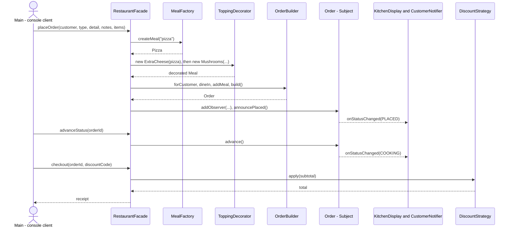

(https://github.com/user-attachments/files/34852369/README.md)
# Restaurant Order System

Final project for the **Software Design Patterns** course (Astana IT University).

A console application for taking and processing restaurant orders. Customers choose meals, add toppings, place a dine-in, takeaway or delivery order, follow it through the kitchen, and pay with an optional discount. The project combines **six design patterns** that work together in one coordinated flow.

## Table of contents

- [Design patterns used](#design-patterns-used)
- [How the patterns work together](#how-the-patterns-work-together)
- [Project structure](#project-structure)
- [Getting started](#getting-started)
- [Using the application](#using-the-application)
- [Example output](#example-output)
- [Design decisions](#design-decisions)
- [Limitations and further work](#limitations-and-further-work)
- [Team](#team)

## Design patterns used

| # | Pattern | Category | Package | Key classes | Role in the system |
|---|---------|----------|---------|-------------|--------------------|
| 1 | **Factory** | Creational | `factory` | `MealFactory`, `MealType`, `Pizza`, `Burger`, `Salad`, `Drink` | Creates a base `Meal` from a meal type or a name typed in the console |
| 2 | **Builder** | Creational | `builder` | `OrderBuilder`, `Order` | Assembles an `Order` step by step (customer, order type, table or address, meals, notes) and validates it in `build()` |
| 3 | **Decorator** | Structural | `decorator` | `ToppingDecorator`, `ExtraCheese`, `Mushrooms`, `Bacon` | Wraps a `Meal` to add a topping to its description and cost; toppings can be stacked |
| 4 | **Facade** | Structural | `facade` | `RestaurantFacade` | Single entry point (`placeOrder`, `advanceStatus`, `checkout`) that hides the other five patterns from the client |
| 5 | **Observer** | Behavioral | `observer` | `OrderObserver`, `KitchenDisplay`, `CustomerNotifier` | `Order` is the subject; the kitchen display and the customer are notified on every status change |
| 6 | **Strategy** | Behavioral | `strategy` | `DiscountStrategy`, `NoDiscount`, `PercentageDiscount` | Interchangeable discount algorithms used when the bill is calculated |

### Factory

`MealFactory.createMeal(MealType)` returns a `Meal` without the caller knowing the concrete class. An overload accepts a plain string such as `"pizza"` for console input and rejects unknown meals with a clear error message.

### Builder

`OrderBuilder` offers a fluent API (`forCustomer`, `dineIn`, `takeaway`, `delivery`, `addMeal`, `withNotes`, `build`). `build()` rejects invalid orders: a missing customer name, an empty meal list, a dine-in order without a table number, or a delivery order without an address. The `Order` constructor is package-private, so an order can only be created through the builder and is immutable except for its status.

### Decorator

`ToppingDecorator` implements `Meal` and holds the `Meal` it wraps, so decorators can be stacked:

```java
Meal meal = new Mushrooms(new ExtraCheese(new Pizza()));
meal.getDescription(); // "Pizza + Cheese + Mushrooms"
meal.getCost();        // 8.50 + 1.00 + 1.50 = 11.00
```

The shared wrapping logic lives once in the abstract base class; concrete toppings only provide their name and price. This avoids a subclass for every meal and topping combination.

### Facade

`RestaurantFacade` is the only class the client talks to. It parses the requested items, asks the factory for meals, applies decorators, drives the builder, registers the observers, and selects the discount at checkout. The console menu in `Main` never touches the other patterns directly.

### Observer

`Order` keeps a list of `OrderObserver`s and notifies them whenever its status moves forward: `PLACED -> COOKING -> READY -> DELIVERED`. `KitchenDisplay` prints kitchen tickets and `CustomerNotifier` sends customer messages that depend on the order type (dine-in, takeaway or delivery). New observers can be added without changing `Order`.

### Strategy

`DiscountStrategy` declares `apply(subtotal)` and `getName()`. `NoDiscount` returns the subtotal unchanged and `PercentageDiscount` subtracts a percentage (validated to be between 0 and 100). At checkout the facade picks a strategy from the discount code and calls `apply()` through the interface, so the price calculation contains no `if` chain over discount types.

## How the patterns work together

1. **Facade** receives the customer's request.
2. **Factory** creates each base meal.
3. **Decorators** wrap the meal with the requested toppings.
4. **Builder** assembles the decorated meals into a validated `Order`.
5. **Observer**: the kitchen and the customer are notified when the order is placed and on every status change.
6. **Strategy** computes the final price when the order is checked out.



## Project structure

```
src
├── Main.java                         Console client (menu and demo scenario)
├── facade
│   └── RestaurantFacade.java         Facade
├── factory
│   ├── MealFactory.java              Factory
│   ├── MealType.java
│   └── meal
│       ├── Meal.java                 Common interface (Decorator component)
│       ├── Pizza.java
│       ├── Burger.java
│       ├── Salad.java
│       └── Drink.java
├── builder
│   ├── OrderBuilder.java             Builder
│   ├── Order.java                    Product and Observer subject
│   ├── OrderStatus.java
│   └── OrderType.java
├── decorator
│   ├── ToppingDecorator.java         Abstract decorator
│   └── topping
│       ├── ExtraCheese.java
│       ├── Mushrooms.java
│       └── Bacon.java
├── observer
│   ├── OrderObserver.java            Observer interface
│   └── listener
│       ├── KitchenDisplay.java
│       └── CustomerNotifier.java
└── strategy
    ├── DiscountStrategy.java         Strategy interface
    └── discount
        ├── NoDiscount.java
        └── PercentageDiscount.java
```

## Getting started

**Requirements:** JDK 16 or newer. There are no external dependencies.

### IntelliJ IDEA

1. Clone the repository and open the project folder.
2. Make sure `src` is marked as the sources root.
3. Run `Main.java`.

### Command line

Linux and macOS:

```bash
javac -d out $(find src -name "*.java")
java -cp out Main
```

Windows (PowerShell):

```powershell
javac -d out (Get-ChildItem -Recurse -Filter *.java src).FullName
java -cp out Main
```

## Using the application

The program starts with a console menu:

| Option | Action |
|--------|--------|
| `1` | Run the built-in demo scenario that shows every pattern |
| `2` | Place an order |
| `3` | Advance an order to its next status |
| `4` | Check out an order (optionally with a discount code) |
| `5` | List all orders |
| `0` | Exit |

**Placing an order**

- Order types: `dine_in` (asks for a table number), `takeaway`, `delivery` (asks for an address).
- Meals: `pizza`, `burger`, `salad`, `drink`.
- Toppings are added with `+`, meals are separated by commas, for example: `pizza+cheese+bacon, drink`.

**Menu and prices**

| Item | Price | | Topping | Price |
|------|-------|-|---------|-------|
| Pizza | 8.50 | | Cheese | 1.00 |
| Burger | 6.00 | | Mushrooms | 1.50 |
| Salad | 4.50 | | Bacon | 2.00 |
| Drink | 2.00 | | | |

**Order lifecycle:** `PLACED -> COOKING -> READY -> DELIVERED`. Statuses can only move one step forward, and an order can be checked out only after it is `DELIVERED`.

**Discount codes**

| Code | Discount |
|------|----------|
| `STUDENT10` | 10% off |
| `HAPPY20` | 20% off |
| *(empty)* | no discount |

## Example output

Output of the demo scenario (menu option `1`), shortened:

```
--- 1. Alice orders dine-in (Factory + Builder + Decorator) ---
[KITCHEN] Order #1: NEW TICKET -> Pizza + Cheese + Mushrooms, Drink (note: No onions)
[NOTIFY -> Alice] Thanks! Your order #1 was received.

--- 3. Alice's order goes through the kitchen (Observer) ---
[KITCHEN] Order #1: cooking started
[NOTIFY -> Alice] Your food is being prepared.
[KITCHEN] Order #1: ready for pickup at the pass
[NOTIFY -> Alice] Your order is ready and will be brought to your table.
[KITCHEN] Order #1: ticket cleared from screen
[NOTIFY -> Alice] Enjoy your meal! Please proceed to checkout.

--- 4. Alice checks out with a discount (Strategy) ---
Order #1 for Alice [DINE_IN, DELIVERED]
  Table: 5
  - Pizza + Cheese + Mushrooms      11.00
  - Drink                            2.00
  Notes: No onions
  Subtotal: 13.00
  Discount (10%): -1.30
  TOTAL: 11.70

--- 5. Error handling ---
Rejected: Order #2 is not delivered yet (PLACED)
Rejected: Unknown meal: sushi
```

The decimal separator follows the operating system locale, so a Russian locale prints `11,00` instead of `11.00`.

## Design decisions

- **One package per pattern** keeps the code easy to navigate and makes each pattern's boundaries obvious.
- **Programming to interfaces:** `Meal`, `OrderObserver` and `DiscountStrategy` are the only types the rest of the system depends on.
- **Open/Closed Principle:** a new topping, observer or discount is a new class, and existing classes stay unchanged.
- **Immutability and validation:** meals, decorators and strategies use `final` fields, `Order` can be created only through its builder, and invalid input fails fast with a descriptive exception.
- **No magic numbers:** prices and limits are named constants.
- **Facade as the single entry point:** the client code in `Main` knows only `RestaurantFacade`.

## Limitations and further work

- Orders are kept in memory only, with no persistence.
- Money is stored as `double`; a production system would use `BigDecimal` or integer cents.
- Discount codes and toppings are mapped to classes with a `switch` in the facade; a registry or a configuration file would remove this edit point.
- More strategies could be added, for example a fixed-amount discount or a payment strategy (cash or card).
- More toppings (for example sauces) and meal categories can be added without changing existing classes.

## Team

| Member | Responsibility | Patterns |
|--------|----------------|----------|
| Shangerey Adilbek | Menu and order creation | Factory, Builder |
| Rymkhan Alizhan | Pricing | Decorator, Strategy |
| Almas Kemal | Order flow and integration | Observer, Facade |
